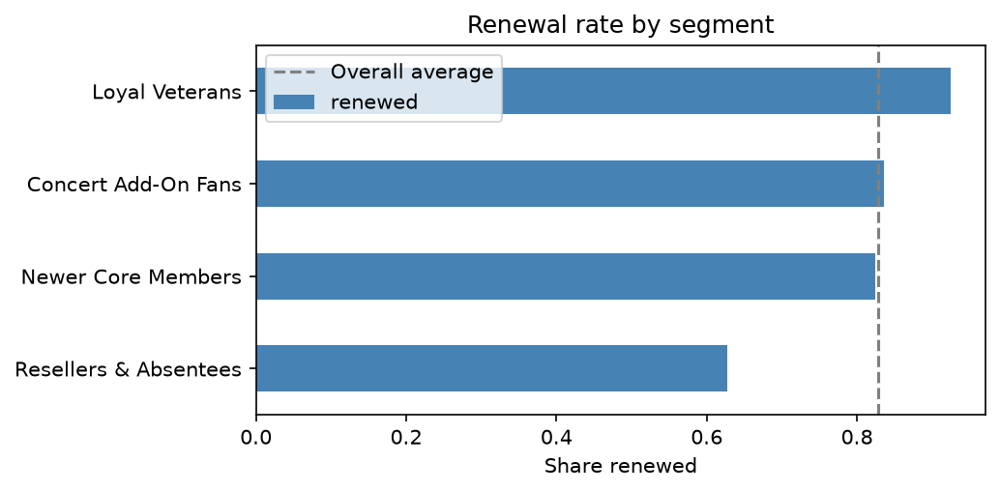
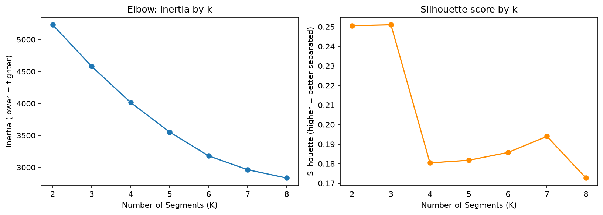
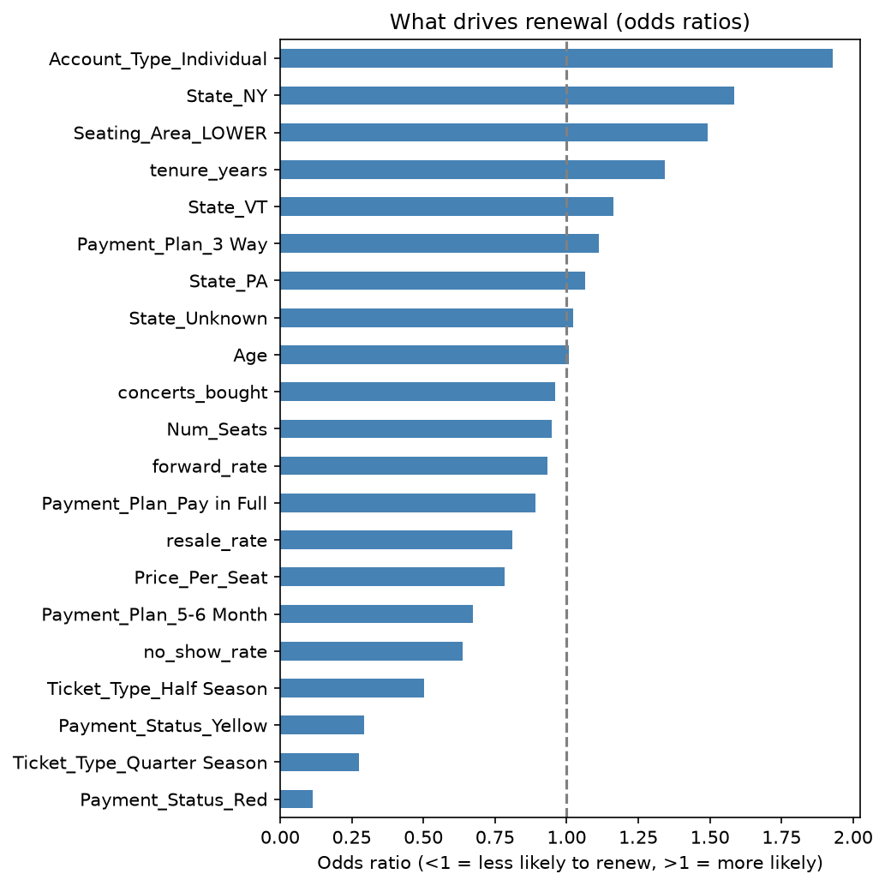

# Season Ticket Retention: Segmentation & Renewal Model

**Which season ticket members are likely to cancel, what kinds of members do we have, and who should the retention team call first?**

This project takes a messy, Archtics-style ticketing export for New York Knicks home games at Madison Square Garden (2025–26), cleans it into a relational model, segments members with k-means, and predicts renewal with logistic regression.

> **Note:** All data is **synthetic**, generated by [`src/generate_data.py`](src/generate_data.py) (seed 42). No real customer data is used. It is intentionally messy to mirror a real ticketing export.

---

## Key Findings

- **Four behavioral segments.** Renewal ranges from **63%** (Resellers & Absentees) to **92%** (Loyal Veterans), a ~30-point gap the model was never told about.
- **Distance matters.** 27% of Resellers & Absentees live in PA or VT, vs. 3–5% in every other segment.
- **Top renewal drivers** (logistic regression, odds ratios):
  - Red payment status cuts the odds of renewing by ~89% vs. Green
  - Quarter and Half plans renew less than Full Season
  - Higher no-show rates lower renewal; longer tenure, Individual accounts and Lower-level seats raise it
- **Revenue at risk:** about **$4.6M** of season value is at risk. Resellers & Absentees carry 2x the average churn risk; Newer Core Members carry the most total dollars at risk because of their size.
- **Deliverable:** a ranked retention call list ordered by revenue at risk.



---

## Data

| File | Grain | Rows |
|---|---|---|
| `ticket_activity_2025_26.csv` | One row per account per event | 25,000 |
| `renewals_2026_27.csv` | One row per account | 889 |

917 accounts, 41 home games + 8 concerts. See the full [data dictionary](data/data_dictionary.md).

---

## Approach

### 1. Exploratory analysis ([`01_eda.ipynb`](notebooks/01_eda.ipynb))
- Classified every blank as junk, meaningful (e.g. blank seat status = kept), fillable, or truly missing
- Found 14 spellings of Payment Plan, 135 spellings of 49 events, 248 duplicate rows, 14 mismatched join keys, and impossible ages (−1, 999)

### 2. Cleaning ([`02_cleaning.ipynb`](notebooks/02_cleaning.ipynb))
- Standardized and mapped every variant to one value
- Derived fields from their source of truth (plan type from Price Code, seat count from Seat Numbers)
- Ran a **conflict check** before filling: it caught un-standardized price codes that mislabeled 75 Balcony accounts as Lower level, and showed Rep Code wasn't a stable account attribute (dropped)
- Split the export into 5 tables: `accounts`, `plans`, `events`, `attendance`, `renewals`
- Validated with grain, referential-integrity, allowed-value and round-trip checks
- A downstream check (concerts_bought = 0 for every account) traced back to Event_Type being derived before Event_Name was standardized; fixed so events show 41 games and 8 concerts

### 3. Segmentation ([`03_segmentation.ipynb`](notebooks/03_segmentation.ipynb))
- Built account-level behavior features: resale rate, forward rate, no-show rate, concerts bought, tenure, price, seats
- Scaled features and tested k = 2–8 with elbow and silhouette
- Chose **k = 4** for business usefulness (silhouette 0.18; segments overlap, so they guide targeting rather than hard boundaries)
- Profiled segments by location and age afterward: 27% of Resellers & Absentees live in PA or VT vs. 3–5% elsewhere; average age is similar (45–48) across segments

| Segment | Accounts | Defining behavior | Renewed |
|---|---|---|---|
| Loyal Veterans | 213 | ~11 yrs tenure, lowest no-show (9%) | 92% |
| Concert Add-On Fans | 104 | ~2.5 concerts each | 84% |
| Newer Core Members | 477 | ~3 yrs tenure, average behavior | 82% |
| Resellers & Absentees | 94 | 21% resold, 40% no-show, 52% corporate | 63% |



### 4. Renewal model ([`04_renewal_model.ipynb`](notebooks/04_renewal_model.ipynb))
- Logistic regression on behavior and profile features, numeric features scaled inside a pipeline
- **Cross-validated AUC: 0.73** (5-fold, stratified)
- Adding the k-means segment didn't improve the model (0.716 vs. 0.725), since segments are built from the same behaviors. Instead, the two models are combined: **the model scores risk, the segments explain who is at risk**
- Scored every member out-of-fold and ranked them by revenue at risk (churn risk × season value)



---

## Limitations
- Synthetic data: relationships were designed, so findings demonstrate the method, not real Knicks behavior.
- At a 25% risk threshold the model catches ~37% of cancellers. It is best used to **prioritize outreach**, not as a yes/no prediction.
- `Cancellation_Reason` and `Processed_Date` are excluded from modeling because they are only known after the renewal decision (leakage).

## Next Steps
- Compare against a random forest
- Add distance from MSG as a numeric feature
- Test outreach impact on the highest-risk segment

---

## Repository Structure
```
season-ticket-retention/
├── README.md
├── requirements.txt
├── data/
│   ├── data_dictionary.md
│   ├── raw/           # synthetic export + renewals
│   └── processed/     # cleaned tables, model_df, call list
├── src/
│   └── generate_data.py
├── notebooks/
│   ├── 01_eda.ipynb
│   ├── 02_cleaning.ipynb
│   ├── 03_segmentation.ipynb
│   └── 04_renewal_model.ipynb
└── figures/
```

## How to Run
```bash
pip install -r requirements.txt
python src/generate_data.py        # recreates data/raw/
```
Then run the notebooks in order.

**Tools:** Python, pandas, NumPy, scikit-learn, matplotlib
